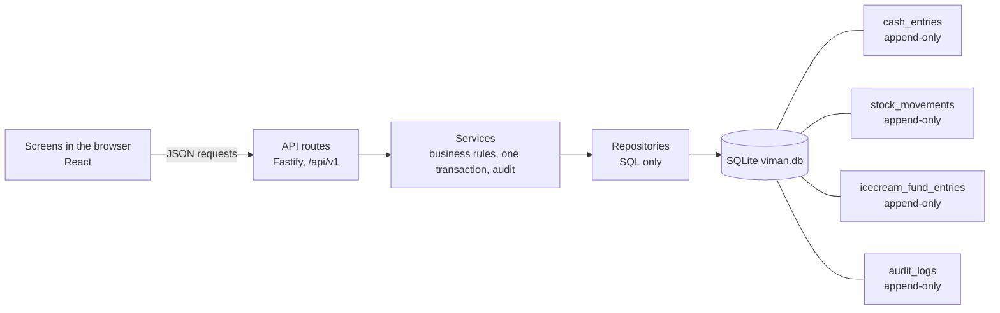
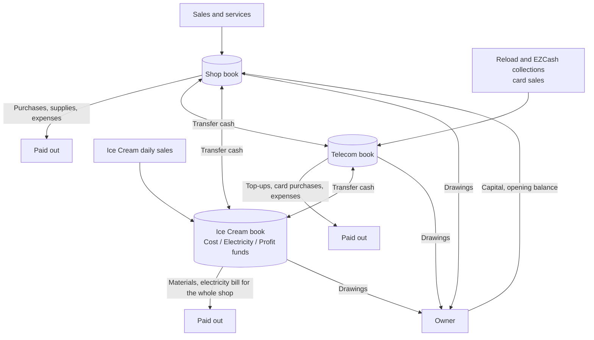

<div align="center">

# Viman Mobile

**Offline shop management for a small mobile shop: sales, stock, telecom, ice cream and three separate cash books, on one Windows PC.**

</div>

> **At a glance**
>
> | | |
> |---|---|
> | Runs | Offline, on one Windows PC, one user. Nothing is sent to the internet. |
> | Data | A local SQLite file (`data\viman.db`) with automatic backups and an optional USB copy |
> | Money | Cash only. Sri Lankan rupees (Rs). Stored in whole cents. |
> | Books | Three separate cash books: **Shop**, **Telecom**, **Ice Cream** |
> | Ledgers | Append-only: nothing is edited or deleted, a mistake is voided and re-entered |
> | Costing | Weighted-average stock cost, with the cost frozen on every sale |
> | Excel | Import opening stock, export every report and a one-click export pack |
> | Safety | Backups at every start and on request, copied to a USB drive, restore with a typed confirmation |
> | Tests | 1,981 server tests passing (102 files, 0 skipped) as of pull request #13 |

---

## Table of contents

1. [What Viman Mobile does](#1-what-viman-mobile-does)
2. [Quick start](#2-quick-start)
3. [First-day checklist (going live)](#3-first-day-checklist-going-live)
4. [Owner guide: screen by screen](#4-owner-guide-screen-by-screen)
5. [How the money is tracked](#5-how-the-money-is-tracked)
6. [Data safety: backups and restore](#6-data-safety-backups-and-restore)
7. [Troubleshooting and FAQ](#7-troubleshooting-and-faq)
8. [Using it from a phone or another device](#8-using-it-from-a-phone-or-another-device)
9. [Claude mobile app and Remote Control (development only)](#9-claude-mobile-app-and-remote-control-development-only)
10. [Roadmap: not built yet and ideas](#10-roadmap-not-built-yet-and-ideas)
11. [For developers](#11-for-developers)
12. [Project status](#12-project-status)

---

## 1. What Viman Mobile does

It is a fresh start: no old records are imported. The owner enters the opening stock and the opening cash balance of each book once (see [section 3](#3-first-day-checklist-going-live)). Every figure is stored in whole cents and every accounting rule is written in `BUSINESS_RULES.md`.

Records are **never edited or deleted**. A mistake is corrected by cancelling ("voiding") the record, which adds a reversing entry, and then entering it again. Everything that is changed or cancelled is written to the **Audit log**.

| Menu item | What it does | Where |
|---|---|---|
| Dashboard | Today and this month at a glance, cash per book, stock alerts, Ice Cream funds, backup status, four charts, Excel export pack | `/` |
| Sales | Point of sale (POS) cart, sale history, returns, voids, void of a return | `/sales` |
| Products | Products, Categories, Suppliers | `/products` |
| Purchases | Goods bought from suppliers, paid in cash; returns and voids | `/purchases` |
| Stock | Stock on hand and value, stocktake, stock losses, personal use | `/stock` |
| Opening Stock | Starting stock at go-live: by hand or from an Excel template | `/opening-stock` |
| Services | Printing, photocopying and other services; service prices; paper and toner supplies | `/services` |
| Telecom | Reload sales, EZCash bills, top-ups; commission income | `/telecom` |
| Expenses | Shop and Telecom running costs | `/expenses` |
| Cash Books | Balances, ledgers, opening balance, cash count, close and reopen a day | `/cash-books` |
| Drawings | Owner drawings, capital put in, transfers between books | `/drawings` |
| Ice Cream | Daily entries, payments, fund moves, the three funds | `/ice-cream` |
| Reports | Profit and loss, cash books, Ice Cream, stock, activity, backdated entries; Excel download | `/reports` |
| Settings | Shop details, commission rates, backups (restore, USB copy), audit log | `/settings` |

On a narrow screen (phone width) the menu becomes a pop-up menu opened by a menu button.

---

## 2. Quick start

1. Install **Node.js 24 LTS** from https://nodejs.org (accept the default options).
2. Double-click **`Start-Viman-Shop.bat`**. The very first run needs the internet once to download the required files, then it builds the screens automatically. This can take a few minutes. Later runs are fast and need no internet.
3. The browser opens at **http://localhost:4300**. Keep the black window open while you work. To stop, press Ctrl+C in the black window, or close it.

What the launcher does each time: checks Node.js, does not start a second copy if one is already running (it just opens the browser), installs files on the first run, rebuilds the screens only if they are out of date, and opens the browser when the server answers. By default only this PC can open the address (see [section 8](#8-using-it-from-a-phone-or-another-device) for phones).

---

## 3. First-day checklist (going live)

Tick these off in order, once:

- [ ] **Settings → General**: check the shop name, address, phone and email.
- [ ] **Settings → Commission rates**: reload commission (default 6.00%) and EZCash commission (default 0.80%).
- [ ] **Products → Categories**: add any extra categories you need (12 are built in).
- [ ] **Products**: add your products (and **Suppliers** if you want them on purchases). Scratch cards are products in the *Scratch Cards* category.
- [ ] **Opening Stock**: enter the stock you already own, by hand or from the Excel template. Use it once.
- [ ] **Cash Books**: for each book press **Set opening balance** with the cash that is in the drawer for that book. For Ice Cream you also choose which fund (Cost, Electricity, Profit) the money belongs to.
- [ ] **Settings → Backups**: press **Backup now**, then set the external USB folder and press **Copy backup now** ([section 6](#6-data-safety-backups-and-restore)).
- [ ] From then on use the other screens every day and **Close day** on Cash Books each evening.

---

## 4. Owner guide: screen by screen

General habits that apply everywhere:

- Dates start at today and cannot be later than today. You may choose an earlier date; the entry is then marked "backdated" and listed in Reports → Backdated.
- Type money in rupees, for example `1,250.50`.
- A form that saves a record cannot be submitted twice by accident.
- Nothing is deleted. To hide a product, category or supplier, make it *inactive*.
- To correct a saved record: **Void** it (a reason is asked, or you type `VOID`), then enter it again correctly.

### 4.1 Dashboard
The home screen. Two cards show *Today* and *This month*: sales and profit for Shop, Telecom, Ice Cream and combined. Other cards show cash in each book, stock value and low-stock products, the Ice Cream funds, days not yet closed, and the newest backup (with the external backup status). Four charts (30-day sales and profit, 12-month profit by segment, top products, cash per book) each have a **Show as table** switch. **Show figures as of** picks another date. The **Excel export pack** card downloads one workbook of the main reports for a date range (default: this month). The Ice Cream block warns when more was spent than was set aside.

**How do I…**
- *See the last month's pack for my accountant?* Dashboard → Excel export pack → choose the dates → **Download Excel pack**.

### 4.2 Sales (tabs: POS, History)

**Record a sale.** POS tab → search a product by name or code (a barcode scanner that types the code and presses Enter also works) → it is added to the cart → change quantity or price if needed → **Save sale**. A cart holding both Shop goods and Telecom scratch cards is saved as two sales, one for each book. You cannot sell more than is in stock. A price below the minimum price or below cost gives a warning but still saves.

**Record a sale with an edited cost.** The "Cost per unit" fills in by itself from stock (weighted average). You may **raise** it, never lower it.
Example: 5 chargers at Rs 100.00 each = Rs 500.00. Automatic cost is Rs 37.40 per unit; you enter Rs 38.00. Cost charged = 5 × 38.00 = Rs 190.00 (automatic Rs 187.00 plus extra Rs 3.00), so profit is Rs 310.00. Stock still leaves at Rs 187.00; the extra Rs 3.00 changes no stock and no cash, it only lowers profit.

**Return items.** History tab → open the sale → **Return items** → choose the quantity.
- *Resalable* items go back into stock at their original cost.
- *Damaged* items are not restocked; revenue and cost are reversed and the loss is counted once.
- The refund leaves the cash book on the return date. The return date cannot be earlier than the sale date.

**Void a sale.** Open the sale → **Void sale** → type `VOID`. Only possible when the sale has no returns still in force.

**Void a return entered by mistake.** Open the sale → **Void return** on that return. Everything is put back as if the return never happened: the returned items leave stock again, the refund comes back into the cash book, revenue and cost stand again.
Rules: voiding must go **newest return first**; the returned units must still be in stock (if you have resold them it is refused); and the return's date must not be in a closed day.
Example: sale of 4 × Rs 1,500 = Rs 6,000 (cost Rs 2,880, profit Rs 3,120). Return 1 unit: refund Rs 1,500, profit Rs 2,340. Void the return: cash +Rs 1,500, stock −1 unit, profit Rs 3,120 again. The original return stays visible, marked "Void".

Services (printing, photocopying) cannot be sold in the POS; use **Services**. Reloads and EZCash use **Telecom**.

### 4.3 Products (tabs: Products, Categories, Suppliers)

**Add a product.** Products → **New product** → choose **Shop or Telecom** first, then a category of that book (or create a new one on the spot), then name, optional code, selling price, minimum price and reorder level. New products are always counted *stock* items. Stock quantity cannot be typed in: it comes from purchases, opening stock and stocktakes.

**Categories.** **New category**: choose Shop or Telecom and a name (the same name may exist in both books). You can rename a category or deactivate it; categories are never deleted. The 12 built-in categories cannot be renamed or moved between books.

**Deactivate a product** that still has stock: you are asked to confirm; its units stay valued but it cannot be sold or purchased until you reactivate it.

**Suppliers**: names and phone numbers.

### 4.4 Purchases
**Record a purchase (with a new product).** **New purchase** → date, supplier, bill number → for each line choose the product (or **New product** right from the line), the number of packs, the pack size and the **total price of the line** → **Record purchase**.
Example: 2 packs × 5 pieces for a line total of Rs 4,000.00 gives 10 units, Rs 400.00 each, added to stock at exactly Rs 4,000.00.

The whole bill is paid in cash from the Shop or Telecom cash book. A bill cannot mix Shop and Telecom products: make two bills. **Return items** sends goods back to the supplier and records the refund. **Void** cancels a whole purchase (type `VOID`) if none of it was returned and its stock is still on hand. (There is no way to void a purchase return; see [section 10](#10-roadmap-not-built-yet-and-ideas).)

### 4.5 Stock (tabs: Stock on hand, Stocktake, Stock losses, Personal use)
- **Stock on hand**: quantity, value and average cost for today or an earlier date, with a check that the figures agree with the stock history.
- **Stocktake** (count the shelves): **New stocktake** gives a count sheet per book. Type your counts, then press **Complete stocktake**. **Complete it immediately after counting, when the shop is quiet.** The system compares your count with the stock on hand at the moment you press the button, so a sale made in between would show up as a false difference. A shortage is a loss at average cost, a surplus a gain at average cost (a surplus on a product with no stock or no value asks you for a unit cost).
  Example: system says 20, you count 17, average Rs 350: loss Rs 1,050.00.
- **Stock losses** (**Record loss**): damaged, lost or expired goods taken out at average cost.
- **Personal use** (**Record personal use**): goods the owner takes for himself, recorded at **cost**, not selling price. It is a drawing, not a sale and not a loss.

Each of these can be voided.

### 4.6 Opening Stock (go-live only)
- **Manual entry**: choose products and enter the quantity with either a unit cost or a total value.
- **Excel import**: download the template, fill in SKU, quantity and cost, upload it (**Check file**), read the preview (each row OK or showing its problem), then **Import opening stock**. It is all or nothing: if any row has a problem nothing is saved. The same file cannot be imported twice while its batch is posted.
- Opening stock adds stock without any cash payment and is not profit. A batch can be voided only while its stock has not been sold or used.

### 4.7 Services (tabs: Print & service sales, Service types, Supplies)
- **Print & service sales**: one button per service type (for example B/W one side Rs 15.00, standard cost Rs 6.50). Enter the number of pages; the price can be changed for a single job. Cash goes into the Shop book and the standard cost is charged as the cost of the job.
- **Service types** (**Add service type**): add any service you sell (printing, photocopying, lamination, phone setup...) with its own price and standard cost, or change a type's name, price, standard cost or active flag. Past sales do not change.
- **Supplies**: paper and toner you buy. Supplies are cash out of the Shop book but are **not** a cost in profit; the Printing variance report compares supplies spent with the standard cost charged.
- Settings → Printing defaults is only a stored reference list and does **not** change prices. Change prices here.

### 4.8 Telecom (tabs: Reloads, EZCash, Top-ups)
- **Reloads** (**Record reloads**): the day's reload sales per provider (Dialog, Mobitel, Hutch, Airtel). The whole amount collected is cash in; your income is the **commission** (default 6.00% of the sales, plus an optional extra amount). Each provider can have its own rate (editor on the same tab).
  Example: Rs 50,000.00 of reloads at 6.00% plus Rs 50.00 extra: cash in Rs 50,000.00, commission income Rs 3,050.00.
- **EZCash** (**Record EZCash bills**): bills collected under Dialog; income is the commission (default 0.80% of the bill total).
  Example: Rs 50,000.00 of bills at 0.80%: cash in Rs 50,000.00, income Rs 400.00.
- **Top-ups** (**Record top-up**): money paid out to a provider for reload credit, or into the EZCash wallet. Not a cost.
- The Telecom cash book is **not** meant to match Telecom profit, because reload credit and wallet balances are not tracked (owner decision).
- Scratch cards are ordinary products sold in Sales.

### 4.9 Expenses
**Add expense** for Shop or Telecom running costs: Water, Rent, Internet, Transport, Repairs, Cleaning supplies, Packaging, Stationery, Other. There is **no Electricity category**: the whole shop's electricity bill is paid from the Ice Cream book (see 4.12). Ice Cream costs are not entered here.

### 4.10 Cash Books
One tab each for Shop, Telecom and Ice Cream, with a period picker. Each shows the opening balance, money in, money out, closing balance and a ledger with a running balance (Ice Cream also shows its three funds).

- **Set opening balance**: once per book (once per fund for Ice Cream). To correct it, void and enter again.
- **Count cash**: type what is in the drawer; any difference is posted as cash over/short and needs a note.
  Example: book says Rs 18,500.00, drawer holds Rs 18,450.00: a Rs 50.00 shortage is posted as a cost.
- **Close day** (locks that date for that book) and **Reopen day** (needs a reason; recorded in the Audit log).
- Closing a day without counting is allowed. A book that goes below zero shows a warning but is never blocked.

**Close the day with a count.** Each evening: Cash Books → the book's tab → **Count cash** with the drawer total → note if there is a difference → **Close day**.

**The closed-day rules.** Anything dated *on* a closed day, including cancelling an old record, is refused until you reopen the day. Anything dated *earlier than the latest closed day* of that book is also refused ("a later day is already closed"): reopen the later day first, or use a date after it.

### 4.11 Drawings (tabs: Drawings, Capital, Transfers)
- **Drawings** (**Record cash drawing**): cash the owner takes from a book (Ice Cream: from a chosen fund). Goods taken for personal use are entered under Stock → Personal use.
- **Capital** (**Add capital**): money the owner puts into a book. Not income.
- **Transfers** (**Transfer cash**): move cash between books; both sides are recorded together.
None of these change profit.

### 4.12 Ice Cream

The Ice Cream cash book is split into three **funds**. In plain words:

| Fund | Think of it as | 
|---|---|
| **Cost** | Money set aside to pay for ice cream materials |
| **Electricity** | Money set aside for the shop's electricity bill |
| **Profit** | What is left over: the day's profit share |

Tabs: **Daily entries**, **Payments**, **Fund moves**, **Funds**.

**Enter a day.** Daily entries → **Add daily entry**: the day's sales, how much to set aside for cost and for electricity; the rest is that day's profit share (a negative share needs an explicit confirmation).
Example: sales Rs 10,000.00, set aside Rs 6,000.00 for cost and Rs 1,000.00 for electricity: profit share Rs 3,000.00. The cash book rises by Rs 10,000.00.

**Pay a bill.** Payments → **Add payment**: materials, the electricity bill (for the **whole shop**) or other costs, each paid from a chosen fund. Paying materials or the electricity bill does not change profit: it settles money already set aside.

**Move money between funds.** Fund moves → **Move money**: no cash moves. Moving Cost or Electricity money into Profit counts as profit only up to what was really left unspent; if you move more, the screen shows the split (profit-eligible part and cash-only part) and asks you to confirm. Moving Profit back into Cost or Electricity reduces recognized profit by the full amount.

**Funds tab.** The three fund balances, the cash book total (they must agree), the **recognized profit** (the official figure), and a warning with "Excess cost not yet charged" and "Profit after excess cost" when more was spent than was set aside. Fund balances are cash allocations, never income. Full rules: `BUSINESS_RULES.md` §10.

### 4.13 Reports (tabs: Profit & loss, Cash books, Ice Cream, Stock, Activity, Backdated)
- *Profit & loss*: Shop, Telecom, Ice Cream or Combined.
- *Cash books*, *Ice Cream* (funds and profit), *Stock* (valuation, movements, losses, product profit, low stock), *Activity* (sales, purchases, drawings, printing variance), *Backdated* (records entered with an earlier date).
- Pick a period and daily or monthly rows; **Download Excel** on each report. Every row uses only the records dated inside its own period.

**Review Backdated monthly** and close the days you have finished with.

### 4.14 Settings (tabs: General, Commission rates, Printing defaults, Backups, Audit log)
General shop details; the two commission rates; a read-only printing reference list; backups ([section 6](#6-data-safety-backups-and-restore)); and the **Audit log**: the history of every change, newest first, with a filter by kind of record.

### Backdated entries
You can enter a missed transaction with an earlier date (never a future date). On every stock-related form a yellow notice appears when the date is earlier than today: stock costing follows the order entries are **saved**, so the cost already stored on earlier sales is **not** recalculated. The entry is flagged and listed in Reports → Backdated.

---

## 5. How the money is tracked

### Three separate cash books
One physical drawer, three *logical* books: Shop, Telecom, Ice Cream. Every product, expense, loss, drawing and cash entry belongs to exactly one book, and Combined profit = Shop + Telecom + Ice Cream. A book's balance is simply opening balance + money in − money out, added up from its ledger.

### What is profit, and what is not
| Counts in profit | Does NOT count in profit |
|---|---|
| Sales minus the cost of what was sold | Owner drawings (cash and goods) |
| Service sales minus standard cost | Capital put in |
| Reload and EZCash **commission** | Transfers between books |
| Shop/Telecom expenses | Opening balances |
| Stock losses and stocktake differences | Provider and wallet top-ups |
| Cash over/short | Stock purchases (they become stock, not cost) |
| Ice Cream **recognized profit** | Printing supplies (compared in a variance report only) |
| | Ice Cream fund balances |

### Weighted-average cost, in plain words
Stock of one product is one pool with a total quantity and a total value. Average cost = value ÷ quantity.
Example: buy 10 for Rs 3,000.00, then 10 for Rs 4,000.00 → 20 units worth Rs 7,000.00, average Rs 350.00. Sell 2: cost of those sales Rs 700.00; the pool is 18 units, Rs 6,300.00. Buy 5 for Rs 2,100.00 → 23 units, Rs 8,400.00 (average Rs 365.22). Sell 3: cost Rs 1,095.65.

### Cost snapshot, extra cost and adjustments
- **Cost snapshot:** the cost of a sale is frozen on the sale line when it is saved; later purchases never change it. Backdated entries never recalculate earlier sales.
- **Extra cost:** the part you add above the automatic cost on a sale. It reduces profit; it moves no stock and no cash.
- **Stock adjustments:** losses, stocktake differences and similar corrections, shown as one line in each book's profit and loss.

### Ice Cream: funds versus recognized profit
Two figures are always shown side by side and never mixed. **Fund balances** are where the money is allocated (Cost + Electricity + Profit always equals the Ice Cream cash book). **Recognized profit** is the official profit and changes only by the day's profit share, profit-eligible releases, re-allocations, other costs paid from the Profit fund, and cash over/short. Taking cash out (a drawing or a transfer) never reduces earned profit. If real spending exceeded what was set aside, a warning shows "excess cost" and "Profit after excess cost"; the official figure is never reduced automatically.

### Closed days, the ordering rule, voids, returns, backdating
- A day is closed per book. Entries on a closed day are refused; entries dated before the latest closed day are refused too (reopen first).
- A void adds reversing rows with the original date, so the correction lands in the same period. A void of a sale is blocked while it has returns; a return can be voided newest first.
- Backdating is allowed (no limit, never in the future) and audited. Reports follow the business date; stock costing follows the saving order.

### Worked examples
1. **Cash only is not profit.** You sell goods for Rs 1,500.00 that cost Rs 700.00: profit Rs 800.00. You then take Rs 500.00 for yourself (drawing): cash falls by Rs 500.00, profit stays Rs 800.00.
2. **Reload commission.** Rs 20,000.00 of Dialog reloads at 6.00%: Telecom cash +Rs 20,000.00, profit +Rs 1,200.00. A top-up of Rs 18,000.00 to the provider: cash −Rs 18,000.00, profit unchanged.
3. **Ice Cream, one month in short** (from `BUSINESS_RULES.md` §10.8): sales Rs 100,000.00 split Cost 60,000 / Electricity 10,000 / Profit 30,000; materials paid 55,000; electricity bill 12,000; move Cost → Profit 3,000; cups 1,000 from Profit. Recognized profit = 100,000 − 55,000 − 12,000 − 1,000 = **Rs 32,000.00**, the same as the true profit.

### Diagram: data flow


### Diagram: money flow between the three books


---

## 6. Data safety: backups and restore

### Where your data lives
- Database: `data\viman.db` (inside the project folder, created on the first start). Keep `viman.db-wal` and `viman.db-shm` next to it if present.
- Backups: `data\backups\`
- To keep the data somewhere else set the environment variable `VIMAN_DATA_DIR` before starting.

### Automatic backups
A backup is made automatically **every time the program starts** and whenever you press **Backup now**. The newest 30 start-up and manual backups are kept. Before any restore a safety copy is made; the newest 10 safety copies are kept. The program does **not** make a new local backup on a timer while it keeps running all day: if you leave it open for days, press **Backup now** at closing time. The Dashboard warns when the newest backup is more than 48 hours old.

### Restore
**Settings → Backups**: choose a backup in the list (**Restore**) or **Restore from file...**, and type `RESTORE` to confirm. A safety backup of the current data is taken first; the file is checked (valid Viman database, SQLite integrity check, not from a newer version of the program); then it replaces the live data. If anything fails after that point the previous data is put back automatically. An older backup is upgraded to the current version after the restore. Anything entered after the backup was made is not in it. The restore is recorded in the Audit log.

### External backups (USB drive)
All automatic backups live on the same PC, so a failed disk or a theft would take the data **and** every backup with it. Keep copies on a USB drive:

1. Plug in a USB drive and note its letter (for example `E:`). Create a folder on it, such as `E:\VimanBackups`.
2. Go to **Settings → Backups → External backup folder**, type the folder path and press **Save**. Press **Copy backup now** to test it.
3. From then on every start-up and manual backup is copied there automatically whenever the drive is plugged in (the system also checks every 10 minutes). Each copy is checked by size and checksum (SHA-256), existing files are never overwritten, and the newest 30 copies are kept. Only files this system created are ever removed from that folder.
4. If the drive is unplugged the shop keeps working normally; you only see a warning on the Settings page and the Dashboard. The Dashboard also warns if **no successful copy has been made for 7 days**.

**Rotation and off-site storage (recommended procedure).** Use two USB drives, A and B. Keep A plugged in during the week. Every Friday after closing, press **Copy backup now**, wait for "copied", then swap: take A home or to another safe place (**off-site**), and plug in B. Next Friday swap back. This way one verified copy is always away from the shop, and a fire, theft or ransomware at the shop cannot destroy every copy. Label the drives with the date of the last swap. Once a month restore the newest external copy into a test folder (or ask for help) to be sure it opens.

**Not allowed: cloud-synced folders.** Backups contain your complete financial records and are **not encrypted**, so the system refuses folders inside OneDrive, Google Drive, Dropbox, iCloud, Box and similar. (The check is by folder name; do not put the backup folder inside any cloud-synced location under another name.) A lost USB drive also exposes the data: keep the drives somewhere safe.

**Verify it with a real USB drive.** The external-backup feature has been tested against ordinary folders and simulated failures (drive missing, name clashes, cloud folders). It has **not** been tested here with a physical USB drive, so please check it yourself once:
1. Set the USB folder in Settings → Backups and press **Copy backup now**; wait for the success message.
2. Open the folder in File Explorer: a backup file with a recent date and a size similar to the one in `data\backups` should be there.
3. Unplug the drive. Keep working: you should see only a warning, no errors. Plug it back in (same drive letter) and press **Copy backup now** again.
4. Confirm the new file appears and the Dashboard warning is gone.
5. Optionally restore that copy on a test copy of the project and check your figures.
6. **Automatic check (recommended):** with the drive plugged in, run this in a Command Prompt in the project folder (it only reads, it never changes anything):
   ```
   node scriptserify-external-backup.mjs E:VimanBackups
   ```
   It compares every copy on the drive with the backup of the same name in `dataackups` (SHA-256), checks that each copy opens as a valid database, flags leftover temporary files and files that do not belong, and asks the running program for its external-backup status. Exit code 0 means everything passed. Options: `--data <data folder>` and `--port <port>`.

### After a power cut or a damaged database
The database is written with full durability, so a power cut normally loses nothing that was already saved. If the file is damaged the system refuses to start (so nothing is written on top of it) and prints these steps in the black window:
1. Close the window.
2. In the `data` folder rename `viman.db` to `viman-damaged.db`; delete `viman.db-wal` and `viman.db-shm` if present.
3. Copy the newest file from `data\backups` (or your USB copy) into `data` and rename the copy to `viman.db`.
4. Start the shop system again.
Anything entered after that backup must be re-entered.

### The "never" list
- Never delete or rename `viman.db`, `viman.db-wal` or `viman.db-shm` while the program runs.
- Never copy `viman.db` alone as a backup while the program is running; use **Backup now**.
- Never keep the only copy of your backups on this PC.
- Never put backups in OneDrive, Google Drive, Dropbox or other cloud folders (they are not encrypted).
- Never start two copies of the program on the same data folder.
- Never edit files inside `server\src\db\migrations`.
- Never give the PC's address to others if you have opened it to the network ([section 8](#8-using-it-from-a-phone-or-another-device)).

---

## 7. Troubleshooting and FAQ

| Message or situation | What it means | What to do |
|---|---|---|
| **Port 4300 is in use** | The program is probably already running | Look for another black window and use it, or close it and start again |
| **"Node.js 24 or newer is required"** | Node.js is missing or too old | Install Node.js 24 LTS from https://nodejs.org, then start again |
| **The build failed** | Screens could not be built | Open a terminal in this folder, run `npm run build`, read the error. If the first-time install failed, check the internet |
| **"The shop database is damaged"** | Possible after a power cut or disk fault; the system refuses to start | Follow [After a power cut or a damaged database](#after-a-power-cut-or-a-damaged-database) |
| **Restore rejected** | The file is not a valid Viman database, failed the integrity check, or is from a newer version | Your current data is not changed. Pick a different backup |
| `DAY_CLOSED` ("That day is closed...") | The date you chose is a closed day for that cash book | Cash Books → **Reopen day** (a reason is required), make the entry, close the day again |
| `BACKDATE_BEFORE_CLOSED_DAY` | A later day is already closed for that book; an earlier-dated entry would change a closed day | Reopen the later closed day first, or use a date after it |
| `FUTURE_DATE_NOT_ALLOWED` | Records cannot be dated after today | Choose today or an earlier date |
| `ELECTRICITY_NOT_ALLOWED` | You tried an Electricity expense in Shop or Telecom | Electricity is paid from the Ice Cream book: Ice Cream → Payments → Electricity bill |
| `RETURN_NOT_NEWEST` | You tried to void a return, but a newer return exists on the same item | Void the newest return first, then this one |
| `RETURN_STOCK_NOT_AVAILABLE` | The returned items are no longer all in stock (probably resold), so the return cannot be undone | Nothing was changed. If it must be undone, first bring the stock back (for example a purchase) or leave the return as is |
| `DUPLICATE_NAME` | A product, category or service type with that name already exists (letter case is ignored). Categories are unique within a book | Use the existing one, or choose a different name. An inactive one must be reactivated first |

Also useful:
- **Why can't I lower the cost on a sale?** The cost fills in from stock and can only be raised, to cover extra cost.
- **Why can't I type a stock quantity on a product?** Quantity comes from purchases, opening stock and stocktakes, so stock always matches its history.
- **A sale cannot be voided.** It has returns still in force: void the returns (newest first) or accept them.
- **Where do I see who changed what?** Settings → Audit log.
- **Does the Telecom cash book match Telecom profit?** No, by design: reload credit and wallet balances are not tracked.

---

## 8. Using it from a phone or another device

By default the program listens on `127.0.0.1`, so **only this PC can open it**. The screens are responsive and adapt to a phone-sized screen. To open it from a phone on the **same Wi-Fi**:

1. **Warning first:** the program has **no login and no password**. Anybody who can reach the address can read and change the shop's books.
2. Before starting the program, set the environment variable `VIMAN_HOST` to `0.0.0.0`. For one session, in a Command Prompt window in the project folder:
   ```
   set VIMAN_HOST=0.0.0.0
   Start-Viman-Shop.bat
   ```
3. On the PC, run `ipconfig` and note the Wi-Fi "IPv4 Address" (for example `192.168.8.106`).
4. On the phone (same Wi-Fi), open `http://<PC address>:4300`, for example `http://192.168.8.106:4300`. The default port is 4300; `VIMAN_PORT` changes it.
5. If the phone cannot connect you may need to allow the port in **Windows Defender Firewall**, for **private networks only**.

What has and has not been checked: with `VIMAN_HOST=0.0.0.0` the program was verified to answer on the PC's Wi-Fi address (a health check on a test port returned status ok). The firewall step and opening the screens **from an actual phone** have **not** been verified.

**Security rules:**
- Use only on a trusted private Wi-Fi that only you control. **Never** on public Wi-Fi or Wi-Fi that shop customers use.
- Never expose the port to the internet (no router port forwarding).
- Switch back to the default (close the window and start normally without the setting) when you do not need the phone.
- The PC must stay switched on and the program must be running.

**Making it permanent (optional, not recommended unless you need it).** `setx VIMAN_HOST 0.0.0.0` stores the setting for your Windows account (it applies to newly opened windows), or make a *copy* of the launcher that contains `set VIMAN_HOST=0.0.0.0` before the `node` line. Either way **every start then exposes the books to the network**, which changes how the launcher behaves. To undo, remove the variable (`setx VIMAN_HOST ""` and delete the user variable in Windows settings) or delete the copied launcher. The original `Start-Viman-Shop.bat` is not changed by this guide.

Note: the launcher opens `http://localhost:4300` when it finds a copy already running, so use the default port when starting from the launcher.

---

## 9. Claude mobile app and Remote Control (development only)

This section is about the **development assistant**, not the shop system. The shop app is local and offline and does **not** connect to the Claude app or to any Claude account.

The Claude desktop app (Code tab) has a **Remote Control** switch in the session toolbar. It links a coding session to the owner's claude.ai account so the session can be followed and steered from claude.ai/code or the Claude mobile app (iOS/Android) while the PC stays on and the desktop app stays running.

Steps:
1. Sign in to the Claude app on the phone with the **same account** as the desktop app.
2. In the desktop app, turn on **Remote Control** for the session (the app asks for approval).
3. On the phone, open the session from the Claude app (Code section) or at claude.ai/code.
4. Turn Remote Control off when finished.

Notes:
- The PC must be awake and online. Project files stay on the PC.
- A session started from the phone cannot have the switch changed there.
- Remote Control is currently **off** for this project's session and is turned on only when the owner asks.
- Exact menu names can differ between app versions; look for "Remote Control" in the session toolbar.

---

## 10. Roadmap: not built yet and ideas

Size guide: **S** = about a day, **M** = a few days, **L** = a week or more (rough).

### 10.1 Not built (checked in the code and documents)
| Item | Note |
|---|---|
| Login, users and roles | No authentication exists |
| Receipt printing (thermal or PDF) | No print code exists |
| Barcode label printing | A scanner can type codes into the POS search, but labels cannot be printed |
| Customer credit or layaway | Cash only, by design |
| Supplier credit or payables | Every purchase is paid in cash |
| Editing a saved record in place | By design: void and re-enter |
| Stocktake with expected quantity at count time | Approved future enhancement; today complete it right after counting |
| Service lines in the POS | Deferred by decision; use Services |
| Void of a purchase return | No such function exists |
| Automatic backups on a timer while the program keeps running | Only at start-up and on request; the 10-minute timer only copies existing backups to the USB folder |
| Encrypted backups | Backups are plain files (hence the cloud-folder refusal) |
| Windows installer, auto-start with Windows, tray icon, auto-update | The launcher is a `.bat` file |
| Other languages (Sinhala, Tamil), dark mode | English, light only |
| Multi-shop or multi-PC | One PC, one user |
| Tax/VAT, discounts and promotions | Not modelled |
| Importing historical data | Fresh start by design |

### 10.2 Recommended before real daily use
| Item | Why it matters to a mobile shop | Size |
|---|---|---|
| Second external backup habit (two USB drives, weekly swap, monthly test) | One disk failure or theft must not end the business | S (a habit, already documented) |
| Receipt printing (thermal or PDF), if customers ask | Customers expect a bill; phone sales often need proof | M |
| Login (at least a password) if the PC is shared or the network is opened | Without it anyone with access can change the books | M |
| Scheduled automatic local backup while running | Shops leave the PC on for days | S |
| Restore-from-external-folder button | Today restore means choosing the file by hand under stress | S |

### 10.3 Nice to have
| Idea | Why it matters | Size |
|---|---|---|
| IMEI/serial tracking for phones | Warranty claims and theft questions need the serial number | M |
| Warranty and repair-job tracking | Repairs are common in mobile shops | L |
| Customer database and loyalty | Repeat customers, contact for pick-ups | M |
| Supplier price comparison and price history, margin alerts | See when a supplier raised a price and when margin is thin | M |
| Reorder suggestions / purchase orders from low stock | Avoid running out of fast sellers | M |
| Discounts and promotions | Festival offers and bundles | M |
| Tax/VAT handling | Needed if the shop registers | L |
| Recurring expense templates | Rent and internet are the same every month | S |
| Month-end closing wizard | One guided routine for counts, closing and reports | M |
| Bank / cash-deposit tracking | Record cash taken to the bank | M |
| PDF reports | Easier to share than Excel | M |
| Email or WhatsApp daily summary | Owner sees the day without opening the PC | M |
| Barcode label printing | Faster stocktake and selling | M |
| Mobile-first POS and offline PWA install on phone | Sell from the phone; needs login first | L |
| Windows installer, auto-start, tray icon, auto-update | Start without a double-click; fewer support visits | M |
| Encrypted backups (would allow cloud storage) | Safer off-site copies | M |
| Sinhala / Tamil, dark mode | Comfort for staff | M |
| Multi-shop / multi-PC | Only if the business grows | L |

---

### 10.4 Hardening backlog from the final independent audit (2026-11-13)
The audit found **no Critical or High** problem and no historical record changed. It listed these smaller items, none reachable through the normal screens except where noted; they are proposals, not yet scheduled (details in `AUDIT_REPORT_2026-11-13.md`):

| Priority | Item | Size |
|---|---|---|
| Medium | Database-level closed-day protection only covers cash entries and three Ice Cream tables; stock-only and profit-only tables are protected by the program but not by database triggers | M |
| Medium | A raw SQL status change (posted to void) is accepted without reversal rows on returns and other documents; the program itself always writes the reversal | M |
| Medium | External backup: after 7+ days with every backup already on the drive, the stale warning cannot be cleared by Copy backup now (only a new backup clears it) | S |
| Medium | External backup: while a drive stays read-only or full, the failure log grows every 10 minutes | S |
| Low | External backup: a copy already on the drive under a different letter case makes that backup fail every run; raw EEXIST text on junction folders; the cloud-name check has some false positives (for example a folder called Boxes) and misses (for example Nextcloud) | S |
| Low | Restore validates structure, not content: a few flipped bytes in a copy can restore without a refusal (use the verify script on the drive) | M |

## 11. For developers

### Tech stack
Node.js 24+ (TypeScript run directly by Node type stripping, no server build) · Fastify 5 · `node:sqlite` (WAL, foreign keys, `synchronous=FULL`) · React 19 · Vite 7 · Tailwind 4 · TanStack Query 5 · React Router 7 · Recharts · ExcelJS · Vitest. Only erasable TypeScript is allowed on the server (no `enum`, `namespace`, parameter properties), and relative imports in `server/` must end in `.ts`. A new dependency needs the owner's approval.

### Repo map
```
Start-Viman-Shop.bat   owner's launcher            scripts/   check-node, needs-build, open-when-ready
server/src/  index.ts (entry) app.ts (composition) routes/ services/ repositories/ db/ lib/ tests/
web/src/     main.tsx App.tsx layout/ pages/<area>/ components/ api/ types/ lib/
data/        created at run time (viman.db, backups/), git-ignored
```
Request flow: route (schema validation) → service (rules, one transaction, audit) → repository (SQL) → database, which repeats the key rules as CHECKs and triggers. Full detail in `ARCHITECTURE.md`.

### Commands (from the project root)
| Command | Purpose |
|---|---|
| `npm run dev:server` | Server with auto-restart (port 4300) |
| `npm run dev:web` | Vite on port 5173 (proxies `/api` to port 4300) |
| `npm test` | Server tests (Vitest) |
| `npm run typecheck` | Type-check server and web |
| `npm run build` | Build the web app into `web/dist` |
| `npm start` | Run the server (serves the built web app) |

Environment variables (read by `server/src/index.ts`): `VIMAN_DATA_DIR` (default `<project>/data`), `VIMAN_PORT` (default 4300), `VIMAN_HOST` (default `127.0.0.1`).

### How to add things (summary; details in `ARCHITECTURE.md`)
- **Migration:** new file `server/src/db/migrations/NNN_name.sql` with the next number; never edit an applied file (checksum is verified); document in the migrations README and `DATABASE_SCHEMA.md`; run `npm test`.
- **Endpoint:** repository function (SQL only) → service function (validation, one transaction, audit, closed-day and future-date checks) → route with a JSON schema → register in `app.ts` → add to `API_CONTRACTS.md` and tests.
- **Screen:** types in `web/src/types`, fetch hooks in `web/src/api`, a folder in `web/src/pages`, routes in `App.tsx`, menu entry in `layout/navItems.ts`.

### Migrations
| # | File | Builds |
|---|---|---|
| 001 | `001_foundation.sql` | Migration table, settings, audit log |
| 002 | `002_audit_append_only.sql` | Audit log cannot be edited or deleted |
| 003 | `003_catalog.sql` | Categories (12 built-in), products, suppliers |
| 004 | `004_purchases_inventory.sql` | Stock movements, cash entries, purchases and returns |
| 005 | `005_stocktake_losses_drawings.sql` | Stocktakes, stock losses, goods drawings |
| 006 | `006_sales_returns.sql` | Sales, sale lines, sales returns |
| 007 | `007_no_hard_deletes.sql` | Delete guards on financial records |
| 008 | `008_sale_extra_cost.sql` | Extra cost on sale lines (rule C13) |
| 009 | `009_telecom.sql` | Reloads, EZCash, top-ups, provider rates |
| 010 | `010_printing.sql` | Service types, print sales, supplies |
| 011 | `011_opening_stock_import.sql` | Opening stock batches and Excel import runs |
| 012 | `012_cashbooks_expenses.sql` | Expenses, opening balances, counts, closings, fund ledger |
| 013 | `013_cash_transfers.sql` | Transfers, cash drawings, capital |
| 014 | `014_icecream.sql` | Ice Cream days, payments, fund moves |
| 015 | `015_category_per_book.sql` | Category names unique per book |
| 016 | `016_closed_day_ordering.sql` | Closed-day ordering protection |
| 017 | `017_void_sales_return.sql` | Void of a sales return |
| 018 | `018_external_backups.sql` | External backup folder and copy log |

### Testing approach and last known results
Vitest, one fresh temporary data folder per test, through the real API. Layers: database tests (constraints, triggers), API tests (status and error codes, idempotency, voids, date rules, closed days), seeded random model checks against an independent BigInt model, invariant tests (stock cache = movements; fund total = Ice Cream cash book), hand-calculated report scenarios, performance checks, and the Ice Cream worked example replayed step by step. `tests/finance/` holds independent expected-value vectors. The web app has no test runner: it is checked by `npm run typecheck`, `npm run build` and manual browser passes.

Last recorded result (pull request #13): **102 test files, 1,981 tests, 0 skipped**; server and web typecheck clean; web build OK. This README did not re-run them.

### Documents
| File | What it holds |
|---|---|
| `BUSINESS_RULES.md` | The approved accounting rules (authoritative; code follows it) |
| `ARCHITECTURE.md` | Layers, directory map, transactions, ledgers, costing, dates, tests, how to extend |
| `DATABASE_SCHEMA.md` | Every table, column, constraint and trigger |
| `API_CONTRACTS.md` | Every endpoint: request, response, error codes |
| `server/src/db/migrations/README.md` | What each migration builds and why |
| `TASKS.md` | Phase checklist and known limitations |
| `IMPLEMENTATION_STATUS.md`, `AGENT_WORK_LOG.md` | History of how each phase was built and verified |
| `DECISIONS_REVIEW.md`, `DOC_REVIEW_FINDINGS.md` | Owner decision review and documentation review findings |

### How it was built
The system was built in phases by several AI agents working in parallel, each in its own git worktree with exclusive files, with an orchestrator owning the shared documents and integration, and independent review and QA passes against hand-calculated figures. New rules go to the owner first and are recorded in `BUSINESS_RULES.md` before code follows.

---

## 12. Project status

All planned phases (1 to 14) are built, including category management and the 14 approved implementation decisions (closed-day ordering protection, void of a sales return, external backups, Services rename, backdated-entry warnings). The last merged change is pull request #13. Known limitations are listed in `TASKS.md`. A final report to the owner and a complete launcher-based browser pass of every screen on a clean database are the open items recorded in `TASKS.md`.

No license file exists in this repository.
